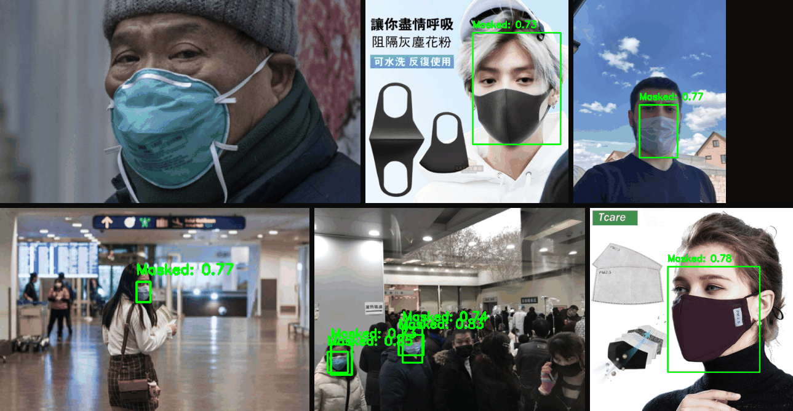
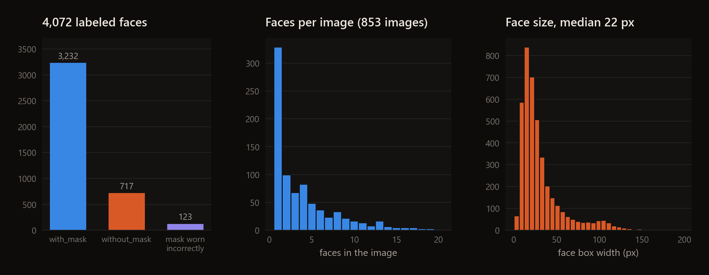
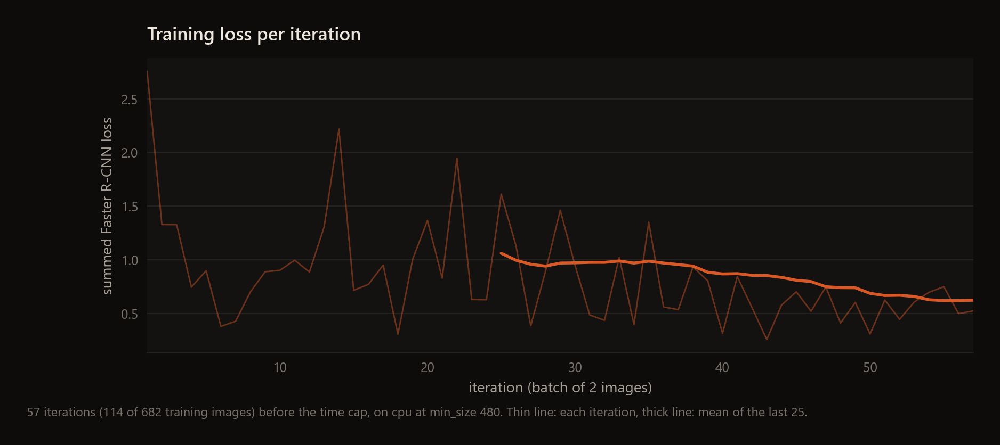
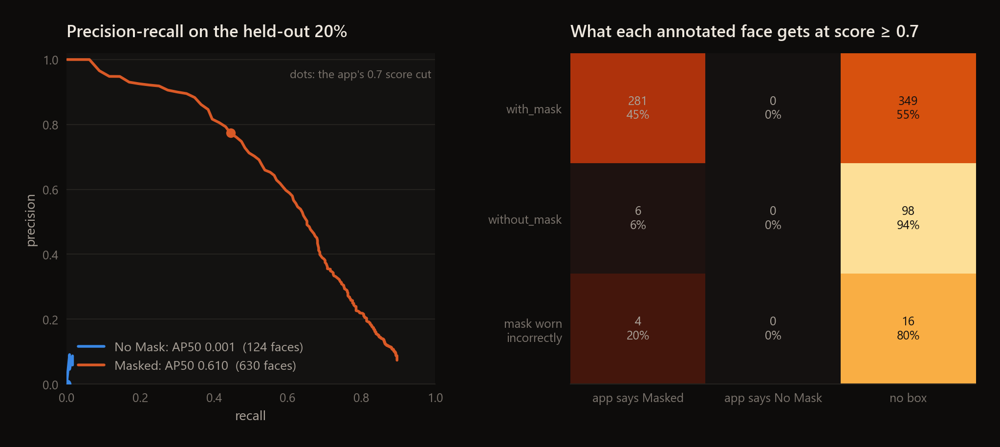

<div align="center">

# Face Mask Detection

**Faster R-CNN (ResNet-50 FPN) fine-tuned to find faces and mark them Masked or No Mask, with a webcam app that draws the result live.**




</div>

This is an experiment and isn't finished: the only model I could train came from a 6-minute CPU run, which finds masked faces but never predicts No Mask, and the full 10-epoch configuration is untested (see Limitations).
`train_model.py` fine-tunes torchvision's COCO-pretrained Faster R-CNN on the Kaggle
[Face Mask Detection](https://www.kaggle.com/datasets/andrewmvd/face-mask-detection) dataset by andrewmvd, and
`face_mask_app.py` runs the saved model on the webcam. The approach follows the Kaggle notebook by
[alperkaraca1](https://www.kaggle.com/code/alperkaraca1/faster-r-cnn-face-mask-detection) (Apache 2.0). The images
above are held-out test images run through the app's own inference and drawing code, using a model from a very short
training run (see Results), so they show the pipeline working rather than how good a full run gets.

## Highlights

- The dataset has 853 images and 4,072 labeled faces, and it is unbalanced: 3,232 with a mask, 717 without and 123 with the mask worn incorrectly. The code merges the last two into one "No Mask" class.
- Faces are small. The median face box is 22 px wide, and one image has 115 faces.
- `train_model.py` holds out 20% of the images (171) but never evaluates on them. `scripts/evaluate.py` rebuilds the same split and reports per-class AP, precision and recall at the app's 0.7 score cut, and what each annotated face ends up labeled.
- The shared GPU on my machine was busy the whole time, so the only model I could train was a 6-minute CPU run that saw 114 of the 682 training images. It already finds masked faces (AP50 0.61) but never predicts No Mask.

---

## How it works

```mermaid
flowchart LR
    A[data/images/*.png<br/>data/annotations/*.xml] --> B[FaceMaskDataset<br/>with_mask → 2 · others → 1]
    B --> C[train_test_split<br/>80 / 20 · seed 42]
    C --> D[Faster R-CNN R50-FPN<br/>COCO weights · 3-class head]
    D --> E[SGD lr 0.001 · momentum 0.95<br/>weight decay 0.05 · batch 2 · 10 epochs]
    E --> F[(fasterrcnn_model.pth)]
    F --> G[face_mask_app.py<br/>webcam · NMS 0.5 · score ≥ 0.7]
    G --> H[green Masked / red No Mask<br/>box + score]
    classDef a fill:#2a1710,stroke:#d95926,color:#ecebe6
    classDef b fill:#0f1d30,stroke:#3987e5,color:#ecebe6
    classDef c fill:#0c231b,stroke:#199e70,color:#ecebe6
    classDef d fill:#1c1a33,stroke:#9085e9,color:#ecebe6
    class A,B,C d
    class D,E,F a
    class G,H c
```



`FaceMaskDataset` reads each PNG with its Pascal VOC XML file. Faces labeled `with_mask` become class 2 ("Masked")
and both `without_mask` and `mask_weared_incorrect` become class 1 ("No Mask"); class 0 is the background. The model
is `fasterrcnn_resnet50_fpn` with COCO weights and a new 3-class box predictor, trained with SGD for 10 epochs at
batch size 2 and saved whole with `torch.save`. The app reads webcam frames, runs the model, applies NMS at IoU 0.5
across both classes, keeps detections scoring at least 0.7, and draws them green for Masked and red for No Mask.



## Results

The numbers below are for a shortened run, not for `train_model.py` as written. I used `scripts/train_short.py`,
which has the same dataset, split, model and optimizer settings but loads images lazily and can stop on a time limit.
It ran on the CPU for 6 minutes at a 480 px input size (torchvision's default is 800) and stopped after 57 iterations,
114 images, a sixth of one epoch. A full 10-epoch run would do far better, so treat these as a floor and as a check
that training, saving, evaluation and the app's drawing code all work together.



Evaluation is on the 171 held-out images, with the app's post-processing (class-agnostic NMS at 0.5). AP50 uses all
detections; precision and recall use the app's 0.7 score cut.

| class | faces in test split | AP50 | precision at 0.7 | recall at 0.7 |
|---|---|---|---|---|
| Masked | 630 | **0.610** | 0.774 | 0.446 |
| No Mask | 124 | 0.001 | n/a (no detections) | 0.000 |



After a sixth of an epoch the model has learned the common class only. It finds 45% of the masked faces at the app's
threshold, labels 6 unmasked and 4 incorrectly-masked faces as Masked, misses every other unmasked face, and adds 72
Masked boxes that don't match any labeled face. No Mask has about 4 times fewer training examples (840 against
3,232), so a longer run is the first thing needed before its numbers mean anything.

## Quickstart

```bash
git clone https://github.com/EllE961/Face-Mask-Detection
cd Face-Mask-Detection
pip install -r requirements.txt
```

Download the dataset from [Kaggle](https://www.kaggle.com/datasets/andrewmvd/face-mask-detection) and unpack it so
you have `data/images/*.png` and `data/annotations/*.xml`. Then:

```bash
python train_model.py              # 10 epochs, writes fasterrcnn_model.pth and plots the loss
python face_mask_app.py            # webcam 0; Esc or q to quit
python scripts/evaluate.py         # held-out 20%: results/metrics.json
python scripts/annotate_samples.py # docs/assets/test_samples.png
python scripts/make_figures.py
```

The run reported above was
`python scripts/train_short.py --epochs 1 --min-size 480 --max-minutes 6 --device cpu`, followed by the last three
commands.

## Repository map

```text
train_model.py                       dataset class, Faster R-CNN setup, 10-epoch training loop
face_mask_app.py                     webcam loop: inference, NMS, 0.7 score cut, drawing
haarcascade_frontalface_default.xml  OpenCV face cascade, not used by either script
requirements.txt
scripts/
  train_short.py                     same training setup with lazy loading, a time cap and a per-iteration log
  evaluate.py                        AP, precision, recall and per-face outcome on the held-out split
  annotate_samples.py                runs the app's inference and drawing on held-out images
  make_figures.py                    dataset, training-loss and evaluation figures
results/                             metrics.json, test_predictions.json, train_log.json, dataset_stats.json
docs/assets/                         figures
```

## Limitations

- No trained weights are in the repo, and the only run I could do here is far too short to judge the method. The 10-epoch configuration is untested on this machine.
- Incorrectly worn masks are folded into No Mask, so the app can't tell them apart, and there are only 123 of them in the whole dataset.
- The classes are unbalanced (3,232 masked against 840 not), and the training loop has no class weighting or sampling to compensate.
- Weight decay is 0.05, about 500 times the 1e-4 that torchvision's detection reference scripts use. It is a likely suspect for the original note that accuracy needed work, but I haven't tested it.
- Most faces are around 20 px wide, while the webcam app sees large, close faces. The dataset is web photos, so webcam accuracy will differ from the held-out numbers in either direction.
- `train_test_split` is applied to the dataset object itself, which loads every image into memory before training starts.

## License

MIT, see [LICENSE](LICENSE). The dataset is by andrewmvd on Kaggle (CC0) and is not included here.
